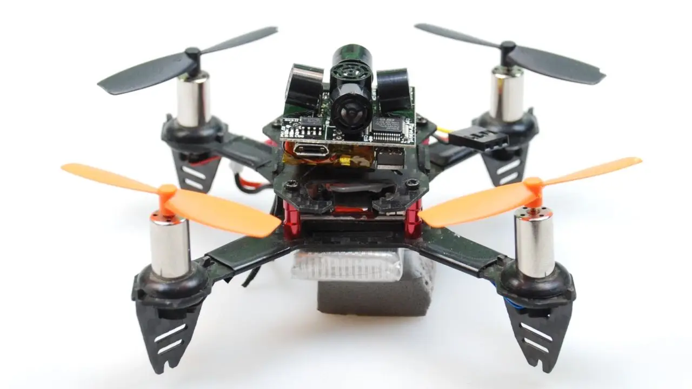
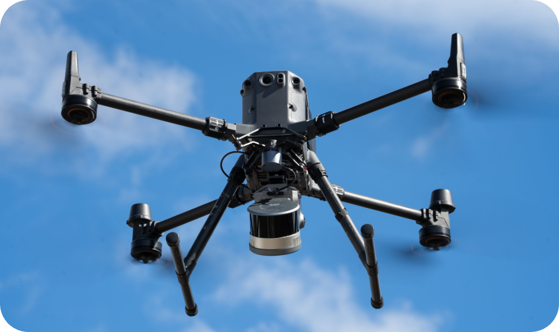
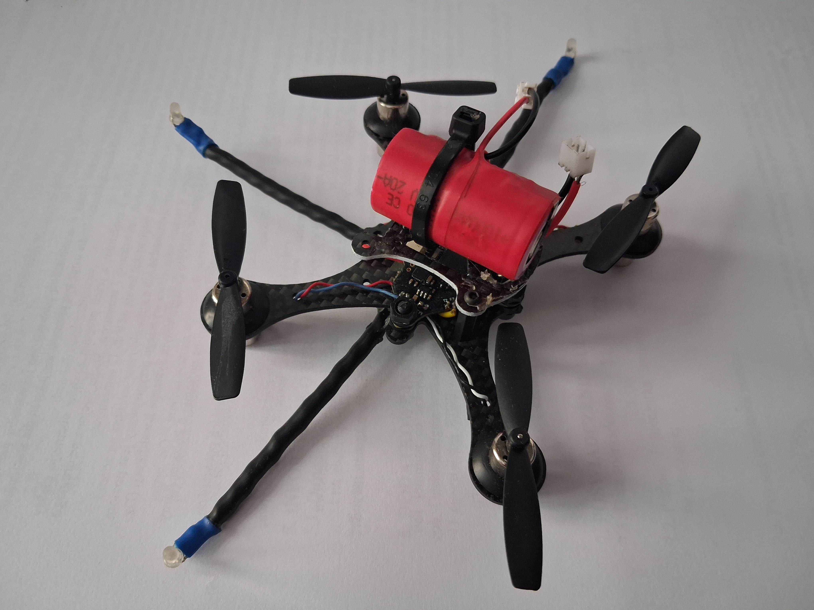
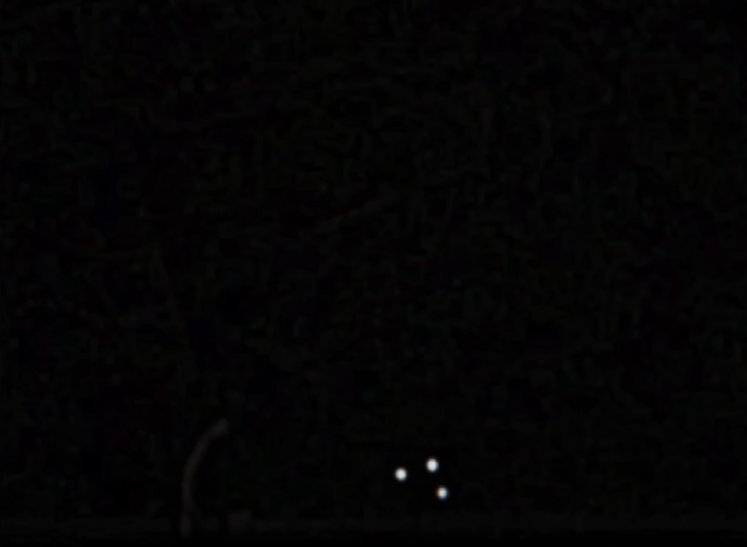
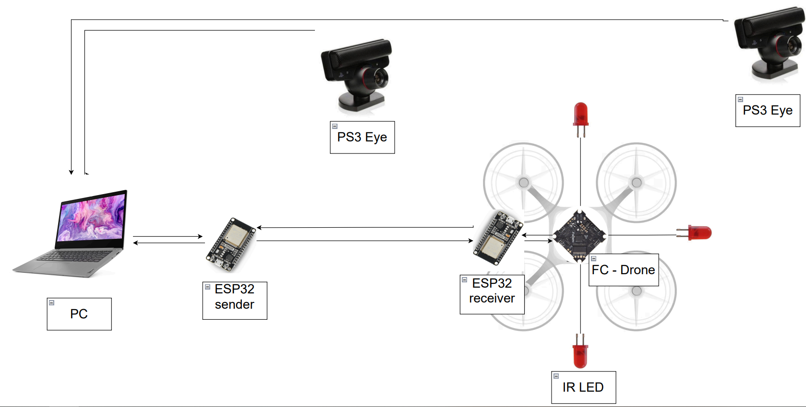

# Development and implementation of a low-cost optical positioning system for unmanned aerial vehicles in an indoor environment

## Abstract
This document is a preliminary report defining the objectives, scope, and methodology for the master's thesis regarding the construction of a navigation system for drones inside buildings. The main goal of the thesis is to create a low-cost Motion Capture system based on consumer cameras (PS3 Eye) and active IR markers, capable of precise UAV positioning in real-time. The report presents an analysis of the market background, a review of existing solutions (State of the Art), and a detailed description of the planned hardware and software architecture.

## Table of Contents
1. [Introduction](#introduction)
2. [Applications of Drones Inside Buildings](#applications-of-drones-inside-buildings)
3. [Literature Review and State of the Art](#literature-review-and-state-of-the-art)
4. [Justification of Technology Choice](#justification-of-technology-choice)
5. [System Implementation](#system-implementation)
6. [Schedule and Expected Results](#schedule-and-expected-results)
7. [Technical Implementation Details (Repository Contents)](#technical-implementation-details-repository-contents)
8. [Bibliography](#bibliography)

---

## Introduction

### Market Background and Motivation
In recent years, rapid development in the Unmanned Aerial Vehicle (UAV) market has been observed. Market forecasts indicate dynamic growth in the drone logistics sector, with a predicted compound annual growth rate (CAGR) of 45.5% over the next decade. A key area that still faces technological barriers is "last mile" logistics and the automation of processes inside large-volume facilities (warehouses, production halls).

In these environments (known as GPS-denied environments), standard satellite navigation systems are unavailable or insufficiently precise. At the same time, there is a growing demand for autonomous transport systems not only in industry but also in domestic applications. The following chapter presents specific examples of drone deployments inside buildings, which justify the need for the development of low-cost positioning systems.

### Goal and Scope of Work
The main goal of this work is the development, construction, and experimental verification of a low-cost, external optical positioning system (Motion Capture). This system is designed to operate in an "off-board" architecture, where cameras placed in the room track the drone's position and transmit corrective data to it.

**Thesis Statement:** It is possible to achieve positioning precision sufficient for stable hovering and simple maneuvers inside rooms using budget vision sensors (PS3 Eye cameras) and proprietary software, constituting an alternative to expensive commercial systems.

The scope of work includes:
*   Hardware adaptation of consumer cameras for infrared operation.
*   Construction of an active IR marker system on the flying platform.
*   Implementation of detection and 3D position triangulation algorithms.
*   Integration of the vision system with the drone's flight controller.

## Applications of Drones Inside Buildings

The development of indoor positioning systems opens the way for a range of practical applications for unmanned aerial vehicles in closed environments. The market context and key application areas constituting the motivation for this work are presented below.

### Market Context
The drone logistics market is experiencing dynamic growth driven by the development of e-commerce and technological progress. According to Future Market Insights, the market value in 2025 is 2.1 billion USD, with a forecast growth to 87.6 billion USD by 2035 (CAGR 45.5%) [fmi2025]. The most dynamic development is predicted after 2030, reflecting the mass adoption of drones in various industrial sectors.

*Figure 1: Forecast of the drone logistics market value for 2020-2035 [fmi2025].*

Key growth factors include increased investment in infrastructure, technological innovations improving battery life and autonomous navigation, the development of regulatory frameworks, and growing social acceptance of drone transport. According to forecasts, by 2025 the number of drone deliveries could reach 3 million daily, and approximately 27.5% of companies plan to implement drone-based logistics solutions [technavio2024].

### Package Loading and Delivery
Drones in closed warehouses automate the process of preparing shipments for dispatch, picking up packages from various picking zones and transporting them to consolidation stations or directly to delivery vehicles [cichosz2020]. Loading inside the building protects shipments from weather conditions (rain, snow, frost) and eliminates the need for multiple movements of goods between zones.

The system achieves 40 deliveries per hour with a payload of up to 4.5 kg (approximately 10 pounds), with tested automation enabling a single operator to supervise up to 20 simultaneous drone missions. Automatic docking stations allow drones to charge batteries and pick up subsequent shipments without human intervention, potentially extending the operational range to the entire logistics complex.

The vision of the future envisions warehouses where drones transport boxes between zones and perform palletization without the need for fixed palletizers. Picking routes can be reconfigured by changing drone programming, and pallets built where they are needed, significantly improving warehouse space utilization [logisticsbureau2024].

### Warehouse Inventory and Inspection
Autonomous drones perform inventory audits in real-time, scanning thousands of warehouse locations in a fraction of the time required by human teams. Inventories that traditionally took days or entire weekends with operations shut down can now be performed within hours without interrupting normal warehouse work [aeologic2025].

IKEA has deployed more than 250 drones in 73 locations across 9 countries, working 24/7 alongside employees, conducting simultaneous stock checks without blocking aisles or disrupting workflow [talkinglogistics2024]. The system eliminates the physically exhausting task of climbing to high racking levels (level 3 and above), radically improving employee safety and allowing them to focus on lighter and more valuable tasks.

Drones also detect anomalies such as blocked aisles, lost pallets, damaged packaging, and empty spaces, generating automatic alerts before problems affect operations. A case study of Jaguar Land Rover shows the use of drones for autonomous inspections of terminals and production halls, where the solution saved an average of 15 minutes during trailer loading and unloading [autologistics2025].

### Transport of Cleaning Robots
Drones serve as a mobile transport platform for cleaning robots, solving a fundamental problem of ground-based devices—the inability to climb stairs and move between building floors. At CES 2026, Dreame (a sub-brand of MOVA) presented the Pilot 70—a system where a drone autonomously locates a vacuuming robot, picks it up using a special gripping mechanism, transports it to the desired floor or balcony, and then returns for it after cleaning is complete [cnet2026].

The concept eliminates the need for separate robots for each floor of a house, radically changing the economics of cleaning automation in multi-level buildings. The HELIOS system uses a similar approach for automatic cleaning of solar panels—a drone places small cleaning robots on the photovoltaic installation and retrieves them after work completion, performing the entire service without the owner's presence [artrobotics2025].

### Summary of Applications
The presented implementation examples show that the demand for precise indoor positioning systems is real and growing. All described applications require stable hovering, precise docking, and autonomous navigation in confined spaces—functionalities that are difficult to achieve for budget constructions without external navigational support. This constitutes the direct motivation for this work.

## Literature Review and State of the Art
Indoor navigation poses a research challenge approached in many ways. Below is a review of the main positioning technologies used in GPS-denied environments, along with their characteristics, advantages, and limitations.

### ArUco Markers
ArUco markers are a visual navigation method based on artificial fiducial markers that can be detected by a camera mounted on the drone. The system uses black-and-white binary patterns in the form of square markers, which can be printed on ordinary paper, making the technology extremely cheap and easy to scale [aruco2025]. The drone camera detects markers in the image, and a pose estimation algorithm (PnP - Perspective-n-Point) calculates the six-degree-of-freedom pose of the camera relative to the marker.

Positioning accuracy depends on the number of visible markers—with 5 or more markers, errors are significantly lower than with a smaller number. Studies show that ArUco markers provide the best accuracy in the range of 0.25-2 meters, with accuracy decreasing as distance increases [aruco_its2025]. A key limitation is the detection range—optimal detection occurs up to about 2 meters. ArUco is often used in conjunction with inertial measurement units (IMU) and Kalman filters to ensure navigation continuity in case of loss of visual contact with markers.

*Figure 2: Drone with a positioning system based on ArUco markers.*

### Ultrasound
Ultrasonic positioning systems use high-frequency acoustic signals emitted by stationary transmitters (beacons), which are received by microphones mounted on the drone. The technology relies on Time-of-Flight measurements and multilateration, where the drone's position is calculated based on differences in signal arrival times from at least three transmitters [ultrasound_pmc2018].

Ultrasonic systems achieve centimeter-level positioning accuracy—commercial solutions like Marvelmind can provide precision of about 2 cm, while typical implementations achieve 9-10 cm accuracy. Hybrid systems combining ultrasound with Time-of-Flight cameras can provide accurate 3D positioning [geoscan2018]. The key advantage of acoustic signals is the lack of penetration through walls, which eliminates the multipath effect characteristic of radio systems. Main limitations include sensitivity to environmental conditions—air turbulence, temperature, humidity, and noise affect measurement accuracy.

*Figure 3: Drone with an ultrasonic positioning system.*

### LiDAR / SLAM
LiDAR technology combined with SLAM (Simultaneous Localization and Mapping) algorithms constitutes one of the most precise solutions for indoor drone navigation. The LiDAR system emits laser pulses and measures their return time, generating high-resolution point clouds [lidar_irjweb]. SLAM algorithms process this data in real-time, enabling simultaneous localization and environment map building.

These systems achieve centimeter-level precision—commercial solutions like Elios 3 with the Flyaware system provide an accuracy of 6 cm in real-time mode and 2 cm after processing [mfe_elios2024]. A key challenge in dynamic environments is separating static elements from moving ones. The main disadvantages of LiDAR technology are the high mass of sensors, significant hardware cost, and high demand for computing power—the system must process dense point clouds in real-time.

*Figure 4: Drone equipped with a LiDAR scanner for SLAM navigation.*

### Visual Inertial Odometry (VIO)
VIO represents a popular "on-board" solution, combining data from cameras with IMU measurements for precise estimation of the drone's position. The system detects and tracks visual features (feature points) on subsequent image frames, simultaneously fusing this information with inertial measurements [vio_pmc2024]. Modern implementations achieve latencies of 5-10 ms, demonstrating the possibility of real-time operation even on resource-constrained platforms.

The VIO method is widely used in commercial products (e.g., DJI) due to the relatively low cost and low mass of sensors. The main problem with this technology is unreliability in difficult lighting conditions and in environments with poor or uniform texture. Studies show that despite excellent results on datasets, VIO algorithms often fail in real conditions due to external disturbances and unstable lighting [vio_arxiv2023].

*Figure 5: Visual Inertial Odometry.*

### UWB Radio Technology
UWB (Ultra-Wideband) is an indoor positioning technology based on short, high-frequency radio pulses, which has achieved great popularity in industrial applications. The system uses Time-of-Flight or Time Difference of Arrival (TDoA) measurements between a tag on the drone and base stations [uwb_elsevier2023].

Typical UWB positioning accuracy is 10-30 cm, with 10 cm achievable in 2D space, while in 3D, accuracy drops to about 30 cm. The system offers a refresh rate of up to 200 Hz with a latency of just 5 ms. UWB is characterized by high resistance to multipath effects and low latency, making it ideal for complex environments like factories or warehouses [uwb_tmk2025]. The main limitations are insufficient precision for applications requiring centimeter-level docking accuracy.

### Motion Capture Systems (MoCap)
Motion Capture systems constitute one of the most precise solutions for drone positioning in GPS-denied environments, used mainly in research laboratories. The technology relies on a network of infrared cameras detecting reflective markers placed on the drone [px4_mocap2025]. The most popular commercial systems include VICON, OptiTrack, NOKOV, and Qualisys, which achieve sub-millimeter positioning accuracy—the VICON Tracker 4 system offers precision up to 0.017 mm [vicon2025].

These systems provide real-time tracking with low latency, delivering complete six degrees of freedom (6-DOF) data. Motion capture enables vehicle state estimation, serves as ground-truth in localization experiments, and supports rapid prototyping of autonomous systems. The main limitations of the technology are the very high infrastructure cost, the necessity of installing multiple cameras, and the limited operating range restricted to a previously prepared room. For these reasons, MoCap systems are used almost exclusively in academic centers and R\&D facilities.

*Figure 6: Operating principle of a Motion Capture system.*

## Justification of Technology Choice

### Comparative Analysis of Positioning Methods
Based on the literature review, a comparative analysis of available technologies was conducted regarding key requirements for indoor drone navigation: precision, latency, cost, and implementation complexity.

*   **ArUco Markers** - Very cheap and easy to install, but limited detection range (up to 2 m) and the necessity of mounting a camera on the drone increase the mass and power consumption of the flying platform.
*   **Ultrasound** - Centimeter accuracy at low cost, but sensitivity to air turbulence generated by drone rotors and environmental limitations (temperature, humidity) rule out reliable operation.
*   **LiDAR/SLAM** - Highest precision and autonomy, but high sensor mass, costs in the thousands of dollars, and demand for computing power make this technology unattainable for budget constructions.
*   **VIO** - Popular commercial solution, but unreliability in low light conditions and uniform textures (typical for warehouses and halls) constitutes a critical limitation.
*   **UWB** - Attractive price-to-performance ratio, but 10-30 cm accuracy is insufficient for precise docking and maneuvers in confined spaces.
*   **Motion Capture** - Sub-millimeter precision and low latency, but the cost of commercial systems (VICON, OptiTrack) reaching tens of thousands of dollars rules out applications outside research labs.

Among the analyzed methods, Motion Capture technology provides the best parameters in terms of precision and latency. The main barrier to implementing this technology is the high infrastructure cost.

### Concept of a Low-Cost MoCap System
Within the scope of this work, it was decided to verify whether it is possible to achieve usable positioning precision using components costing a fraction of the price of professional systems. The proposed approach is based on the following assumptions:

1.  **Cheap consumer cameras** - Instead of specialized high-sensitivity IR cameras, use of modified Sony PS3 Eye cameras (unit cost: approx. 20-30 PLN on the secondary market), which can record infrared light after removing the IR-cut filter.
2.  **Active IR markers** - Instead of passive retro-reflective markers requiring expensive illuminators, use of LEDs emitting light in the near-infrared band. An active light source ensures high contrast against the background even when using cheap CMOS sensors.
3.  **Improvised optical filters** - Use of materials blocking visible light (e.g., magnetic media from a 3.5'' floppy disk), eliminating the need to purchase specialized band-pass filters.
4.  **Off-board architecture** - Use of a cheap flying platform (hobby drone) without an advanced onboard computer forces the transfer of visual calculations to an external PC. This approach allows utilizing full computing power without limitations imposed by the mass, power consumption, and cost of the flying platform.

### Problem Statement

**Thesis Statement:** It is possible to build a low-cost optical positioning system of the Motion Capture type, capable of precise drone tracking in real-time, using consumer components with a total cost not exceeding 500 PLN.

**Research Questions:**
1.  What positioning accuracy can be achieved using modified PS3 Eye cameras and active IR markers?
2.  Will the latency in the measurement loop be low enough for stable flight control in the feedback loop?
3.  What are the range and lighting condition limitations for the proposed solution?

**Main Technical Challenges:**
*   Achieving low latency (latency < 50 ms) in the entire loop: acquisition - processing - transmission - control.
*   Effective filtration of the visible spectrum using improvised materials.
*   Unambiguous determination of drone orientation with a limited number of markers (solving the *pose ambiguity* problem).

## System Implementation

As part of the work, a functional prototype of the positioning system was built, consisting of a flying platform equipped with active IR markers, modified PS3 Eye cameras, and a wireless communication system based on ESP32 modules.

### Flying Platform
A light drone with 55 mm propellers and brushed motors in a quadcopter configuration was used as the test platform, equipped with a flight controller (FC) running Betaflight software. Three LEDs emitting light in the near-infrared band were mounted on the ends of the drone arms, ensuring high contrast against the background even in variable lighting conditions.

The arrangement of LEDs forms an isosceles right triangle, allowing for unambiguous determination of the drone's orientation. The IR LEDs are powered by 5V from the flight controller (FC), using a 150 Ohm resistor for each diode.

*Figure 7: Constructed test drone with active IR markers on arm ends.*

### Modification of PS3 Eye Cameras
Sony PS3 Eye cameras underwent modification enabling operation in the near-infrared band. The modification process included three stages:

1.  **Removal of the IR-cut filter** - The factory filter blocking infrared was dismantled from the camera's optical system. This filter normally protects the CMOS sensor from IR radiation, which could disturb color reproduction.
2.  **Installation of a visible light filter** - Material from a magnetic medium (3.5'' floppy disk) was mounted in place of the removed filter; this blocks visible light (below approx. 700 nm) while transmitting near-infrared radiation. Thanks to this, the camera "sees" only the IR diodes, ignoring ambient lighting.
3.  **Focal length correction** - After removing the original IR-cut filter, the optical path in the camera changes, causing image defocusing. This problem was solved by sanding down the lens mount element, allowing the lens to be moved closer to the CMOS sensor and restoring image sharpness.

An example image from the camera after modification is shown in Figure 8 - only three bright points corresponding to the IR diodes on the drone are visible, while the rest of the scene (room lighting, background) is completely eliminated by the filter.

*Figure 8: Image from the modified PS3 Eye camera.*

### System Architecture
The system operates in an off-board architecture, where all visual calculations are performed on an external PC, and only processed positional data is sent to the drone. The connection diagram is presented in Figure 9.

*Figure 9: Diagram of the positioning system architecture.*

**Ground segment**
*   **PS3 Eye Cameras** -- connected to PC via USB.
*   **PC Computer** -- processes data from cameras.
*   **ESP32 Sender** -- module connected to PC via serial port (USB), responsible for transmitting positional data from PC to the drone.

**Air segment**
*   **ESP32 Receiver** - module mounted on the drone, wirelessly receiving positional data from the ground segment. Communication between ESP32 modules is realized using the ESP-NOW protocol, ensuring the lowest possible latency.
*   **Flight Controller (FC)** - controller responsible for driving the motors. It communicates with the ESP32 receiver via a serial interface using the MSP (MultiWii Serial Protocol).
*   **IR LED Markers** - three infrared diodes mounted on the drone arms, creating an asymmetrical geometric pattern.

## Schedule and Expected Results

*   **Stage 1: Preparation and calibration of the measurement station (Completed).**
    The test drone equipped with active markers was assembled. A station with PS3 Eye cameras was prepared, and preliminary optical filter tests were conducted. The ESP32 communication system allows for the transmission of positional data from PC to drone.

*   **Stage 2: Implementation of position recognition algorithms.**
    Development of software realizing:
    *   Intrinsic and extrinsic camera calibration.
    *   Image segmentation (thresholding) to detect diodes.
    *   Matching detected 2D points to the geometric triangle model (solving the PnP problem - *Perspective-n-Point* or multi-camera triangulation).

*   **Stage 3: Implementation of control and autonomous supervision.**
    Closing the feedback loop. Implementation of PID controllers responsible for maintaining the set position (x, y, z) and orientation (yaw). Tuning controller parameters to minimize oscillations.

*   **Stage 4: Flight tests.**
    Conducting a series of experiments verifying:
    *   Hover stability.
    *   Tracking a simple trajectory.
    *   Attempt at autonomous docking (landing at a designated point).

*   **Stage 5: Data analysis.**
    Analysis of collected data, evaluation of system accuracy, and formulation of final conclusions.

## Technical Implementation Details (Repository Contents)

This repository contains the implementation of the custom control system based on ESP32 modules, utilizing the ESP-NOW protocol for wireless data transmission and the MSP protocol for communication with the flight controller.

### System Assumptions
The system enables drone control using a controller (joystick/RC transmitter) connected to a computer or a dedicated web interface. Data is transmitted to the drone via a radio bridge built from two ESP32 modules.

### Connection Architecture
1.  **PC (Python Script / Web Interface):** Reads control data (e.g., from a simulator joystick), maps it to RC channels, and sends it to the transmitter.
2.  **Transmitter (ESP32 TX):** Receives data from the PC (via Serial or WebSocket) and transmits it wirelessly using the low-latency **ESP-NOW** protocol.
3.  **Receiver (ESP32 RX):** Receives ESP-NOW packets, converts them into **MSP (MultiWii Serial Protocol)** frames, and sends them directly to the Flight Controller (FC).
4.  **Telemetry:** The system supports bidirectional communication – the receiver retrieves battery voltage data from the FC (MSP_ANALOG command) and sends it back to the transmitter, and then to the PC.

### What Has Been Implemented
*   **Joystick Support (Python):** The `scripts/joystick_bridge.py` script uses `pygame` to handle HID controllers. It includes logic for mapping axes to RC ranges (1000-2000 µs) and handling switches (e.g., ARM).
*   **Wireless Communication:** Implementation of a stable ESP-NOW connection with MAC address pairing and real-time data exchange.
*   **Flight Controller Integration:**
    *   State machine implementation for **MSP** protocol handling.
    *   Sending control data `MSP_SET_RAW_RC` (16 channels).
    *   Retrieving and displaying telemetry (battery voltage).
*   **Alternative Interfaces:** An additional transmitter version with a built-in Web server and WebSocket control interface.
*   **Diagnostic Tools:** Scripts for detecting connected joysticks and handling Blackbox data transmission via ESP-NOW.

### Project Structure
*   `/scripts/`: Python scripts for joystick handling and Serial data bridging.
*   `/src/main.cpp`: Main transmitter (TX) code working with the PC.
*   `/programs/`: Various software versions (Receiver, Blackbox version, Web version).
*   `platformio.ini`: PlatformIO environment configuration for ESP32.

### Requirements
*   2x ESP32 (e.g., DevKit V1).
*   Flight Controller (FC) supporting MSP protocol on a free UART port (e.g., Betaflight, INAV).
*   RC transmitter or joystick connected to PC (optional for `joystick_bridge` mode).
*   Python 3.x + `pygame`, `pyserial`.

### Quick Start
1.  Identify the MAC address of your ESP32 receiver.
2.  Enter the MAC address in `src/main.cpp` (transmitter).
3.  Compile and upload the firmware to both ESP32 modules.
4.  Connect the receiver to the Flight Controller's UART port (TX->RX, RX->TX).
5.  Run `scripts/joystick_bridge.py` on your computer and start controlling.

## Bibliography

*   [fmi2025] Future Market Insights. (2025). Drone Logistics & Transportation Market - 2035. Available: https://www.futuremarketinsights.com/reports/drone-logistics-transportation-market
*   [technavio2024] Technavio. (2024). Drone Logistics And Transportation Market Growth Analysis 2024-2028. Available: https://www.technavio.com/report/drone-transportation-and-logistics-market-industry-analysis
*   [cichosz2020] Cichosz, M. (2020). *Drones in last-mile logistics*. SGH Warsaw School of Economics. Available: https://cor.sgh.waw.pl/bitstream/handle/20.500.12182/959/
*   [logisticsbureau2024] Logistics Bureau. (2024). The Future of Drones in Supply Chain Management. Available: https://www.logisticsbureau.com/drones-in-distribution-thinking-inside-the-box/
*   [autologistics2025] Automotive Logistics. (2025, December 8). JLR pilots drone inspections to cut factory downtime and improve safety.
*   [talkinglogistics2024] Talking Logistics. (2024). Walmart and IKEA: Drone Delivery vs. Drones in the Warehouse. Available: https://talkinglogistics.com/2024/08/26/walmart-and-ikea-drone-delivery-vs-drones-in-the-warehouse/
*   [aeologic2025] Aeologic Technologies. (2025). How Drones Are Transforming Warehouse Inventory Management and Tracking. Available: https://www.aeologic.com/blog/how-drones-are-transforming-warehouse-inventory-management-and-tracking/
*   [cnet2026] CNET. (2026, January 8). I Watched a Drone Pick Up a Robot Vacuum and (Sort Of) Carry It Up the Stairs at CES 2026. Available: https://www.cnet.com/home/kitchen-and-household/watched-drone-pick-up-robot-vacuum-carry-it-up-the-stairs-ces-2026/
*   [artrobotics2025] ART Robotics. (2025). HELIOS - Automated Cleaning Service for Solar Panels. Available: https://art-robotics.com/cases/helios/
*   [aruco2025] arXiv. (2025). Investigation of ArUco Marker Placement for Planar Indoor Localization. Available: https://arxiv.org/html/2509.17345v1
*   [aruco_its2025] Institut Teknologi Sepuluh Nopember. (2025). Navigasi Otonom Indoor Drone Menuju Posisi Target Berbasis Pendeteksian Objek dan Penanda ArUco. Available: https://repository.its.ac.id/116380/
*   [ultrasound_pmc2018] Paredes, J.A. et al. (2018). 3D Indoor Positioning of UAVs with Spread Spectrum Ultrasound and Time-of-Flight Cameras. PMC/Sensors. Available: https://pmc.ncbi.nlm.nih.gov/articles/PMC5795612/
*   [geoscan2018] Geoscan. (2018). Pioneer Indoor navigation system - Ultrasonic local navigation system. Available: https://www.geoscan.ru/en/products/pioneer/locus
*   [lidar_irjweb] International Research Journal of Innovations in Engineering and Technology. LiDAR SLAM FOR INDOOR ROBOT NAVIGATION IN DYNAMIC ENVIRONMENT. Available: https://www.irjweb.com/LiDAR%20SLAM%20FOR%20INDOOR%20ROBOT%20NAVIGATION%20IN%20DYNAMIC%20ENVIRONMENT.pdf
*   [mfe_elios2024] MFE. (2024). Elios 3: The First Indoor LiDAR Mapping Drone. Available: https://mfe-is.com/lios-3-the-first-indoor-lidar-mapping-surveying-drone/
*   [vio_pmc2024] PMC/MDPI. (2024). Event-Based Visual/Inertial Odometry for UAV Indoor Navigation. Available: https://pmc.ncbi.nlm.nih.gov/articles/PMC11722967/
*   [vio_arxiv2023] Bencak et al. (2023). Deployment of Reliable Visual Inertial Odometry Approaches for Unmanned Aerial Vehicles in Real-world Environment. arXiv. Available: https://arxiv.org/abs/2302.01867
*   [uwb_elsevier2023] Lin, H.Y. (2023). GNSS-denied UAV indoor navigation with UWB incorporated visual inertial odometry. Measurement, Elsevier. Available: https://www.sciencedirect.com/science/article/abs/pii/S026322412201452X
*   [uwb_tmk2025] The Mobile Knowledge. (2025). White paper: Master Indoor Positioning with UWB Technology. Available: https://www.themobileknowledge.com/knowledge-base/white-paper-master-indoor-positioning-with-uwb-technology/
*   [px4_mocap2025] PX4 Documentation. (2025). Flying with Motion Capture (VICON, NOKOV, Optitrack). Available: https://docs.px4.io/main/en/tutorials/motion-capture
*   [vicon2025] Vicon Motion Systems. (2025). Motion Capture Systems for Drone Tracking and UAVs. Available: https://www.vicon.com/applications/engineering/autonomous-vehicles/
